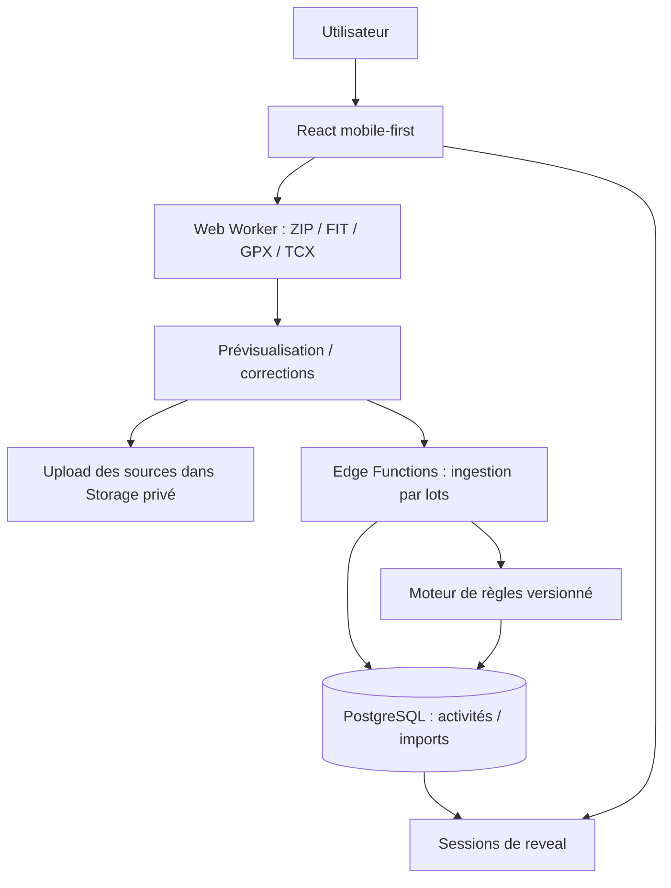

# LAUNCH V1 — Architecture technique

## 1. Objectifs et choix

- **Web mobile-first** : React  + TypeScript strict + Vite, Tailwind CSS, shadcn/ui, React Router.
- **Données client** : TanStack Query ; **formulaires** : React Hook Form + Zod si nécessaire.
- **Backend** : Supabase Auth, PostgreSQL, Storage privé, Edge Functions, migrations SQL.
- **Traitement ZIP/FIT/GPX/TCX** : Web Workers + bibliothèques de parsing ; `@garmin/fitsdk` pour FIT, une bibliothèque ZIP à sécurité vérifiée, parseur GPX/TCX XML sans interprétation de DTD/entités.
- **Tests** : Vitest (règles, parsing, hashing, utils), tests SQL RLS avec Supabase CLI, Playwright (flux de bout en bout mobile).
- **Distribution** : PWA d'abord ; Capacitor plus tard. Pas de serveur Node permanent en V1 ; Edge Functions / tâches par lots si besoin.

## 2. Architecture logique



### Règle de séparation

1. **Parseur** : transforme un fichier externe en candidat `ParsedActivity`, sans décision de récompense.
2. **Normalisation** : sport source → catégorie (`running`, `trail`, `cycling`, `swimming`, `unsupported`, `unknown`) ; métriques SI + provenances.
3. **Validation** : plausibilité, conformité, doublons, états `needs_review`.
4. **Ingestion** : écrit les activités avec idempotence/transactions.
5. **Moteur de récompenses** : calcule à partir des activités validées ; ne fait aucun appel réseau ni parsing et n'a aucune dépendance au navigateur.
6. **Présentation** : lit les cartes déjà attribuées et anime des reveals ; n'accorde jamais de carte.

## 3. Contrats métier TypeScript proposés

```ts
type SportSlug = 'running' | 'trail' | 'cycling' | 'swimming';
type ActivityCategory = SportSlug | 'unknown' | 'unsupported';
type EvidenceLevel = 'file_import' | 'self_reported' | 'provider_verified';
type ActivityState = 'valid' | 'needs_review' | 'excluded' | 'deleted';

interface ParsedActivity {
  sourceFileHash: string;
  sourceFormat: 'fit' | 'gpx' | 'tcx';
  sourceActivityId?: string;
  originalSportName?: string;
  category: ActivityCategory;
  startedAtUtc?: string; // ISO-8601
  distanceM?: number;
  movingDurationS?: number;
  elapsedDurationS?: number;
  elevationGainM?: number;
  provenance: Record<string, string>;
  warnings: string[];
}

interface RewardRule {
  id: string; // identifiant stable de carte
  sport: SportSlug;
  type: 'single_activity_distance';
  thresholdM: number;
  rulesetVersion: string;
}
```

Toutes les valeurs doivent être validées avec Zod avant ingestion ; le serveur contrôle à nouveau le schéma et les règles. Le serveur ne considère pas une simple valeur numérique envoyée par le navigateur comme preuve de fiabilité, même avec un fichier d'origine. **Les imports locaux sont auto-déclarés à partir de fichiers modifiables**, pas des activités certifiées par un fournisseur.

## 4. Import en grand volume

### Étape A — prétraitement local

- Réception d'une liste de `File` : fichiers simples, sélection multiple ou ZIP.
- Parcours de dossiers internes du ZIP sans extraction sur disque ; ignorer les entrées non compatibles.
- Vérifier signature, taille compressée/décompressée, nombre de fichiers, profondeur de dossier et chemins dangereux avant traitement.
- Analyse dans un ou plusieurs Workers ; UI reçoit des événements `discovered`, `parsed`, `invalid`, `duplicateCandidate`, `progress`.
- Éviter le `Promise.all()` sur des milliers de fichiers ; utiliser une file à concurrence limitée.
- Pour chaque activité : conserver `rawSport`, heure source, précision des champs, warnings.

### Étape B — aperçu

- Groupes : **valides**, **à corriger**, **doublons exacts**, **doublons potentiels**, **ignorés**.
- Le sport inconnu ne bloque pas sa conservation, mais n'attribue pas de carte.
- On peut corriger les sports et exclusions avant l'envoi définitif.
- Afficher taille totale à stocker et demander autorisation de conservation des fichiers originaux.

### Étape C — commit par lots

- Créer `import_batch` idempotent (identifiant de session par utilisateur).
- Envoyer les originaux acceptés dans Supabase Storage privé, en chemins prévisibles `user_id/sha256/filename_sanitized` ; la vraie autorisation dépend des politiques de stockage, pas du seul chemin.
- Utiliser upload standard pour les petits fichiers et reprise TUS pour les éléments > 6 Mo selon la documentation Supabase ; ne pas faire transiter un ZIP massif dans une Edge Function.
- Soumettre les métadonnées par morceaux configurables (p. ex. 25–50 candidats), avec une clef d'idempotence par candidat.
- Commit transactionnel : activité / item d'import / droits de fichier / cartes / journal d'attribution / reveal. Prévoir une RPC SQL bien délimitée si plusieurs écritures doivent être atomiques.
- Le client suit l'état persistant du lot et peut réessayer seulement les éléments en erreur.
- Nettoyer les fichiers Storage orphelins via procédure de maintenance ou réconciliation.

### Étape D — reprocessing des sports futurs

- Stocker le sport original même si la catégorie est `unsupported`.
- Lorsqu'un sport ou une règle est publié, lancer un job *replay* sur les données normalisées correspondantes ; si des champs manquent, retraiter le fichier brut privé.
- Rejouer les règles dans la même transaction d'attribution/idempotence ; créer un reveal `new_sport_collection` seulement pour les nouvelles cartes.
- Garder les versions de règles pour diagnostiquer les différences de calcul.

## 5. Déduplication : décisions

| Situation | Action |
|---|---|
| Même utilisateur + SHA-256 identique | Doublon exact, réutiliser la référence existante, ne pas créer d'activité |
| Identifiant source stable identique | Doublon exact si même identifiant et même source |
| Début proche + sport et métriques proches | Doublon probable, demande de confirmation |
| Deux courses successives proches | Ne pas fusionner automatiquement |
| Fichier différent mais même activité déjà déclarée manuellement | Proposer rapprochement et conserver la traçabilité des sources |
| Réimport du même lot après timeout | Aucun changement de possessions, réponse idempotente |

Créer des contraintes SQL sur les identifiants forts et des index pour la comparaison des candidats ; le score fuzzy n'est jamais une raison suffisante pour supprimer des données utilisateur.

## 6. Sécurité

- RLS activé sur toutes les tables utilisateur exposées ; `user_id = auth.uid()` pour les lectures autorisées ; privilèges SQL explicites.
- `card_definitions` et `sports` publics en lecture, non modifiables côté client.
- `user_cards`, `achievement_events` et `reveal_items` : écriture seulement par fonctions serveur autorisées, jamais `INSERT` direct depuis navigateur.
- Storage : bucket privé pour les originaux ; droit de lecture/suppression par propriétaire, upload contrôlé par permissions et quotas.
- Contrôles de taille et de formats côté client **et serveur** ; jamais se fier à l'extension.
- Éviter les ressources externes sur les pages d'analyse de traces ; aucune coordonnée GPS dans analytics/erreurs.
- Exigences explicites de confidentialité (suppression, export, durée de conservation) avant production.

## 7. Extensions futures sans réécriture

Prévoir des interfaces (sans les implémenter) :

```ts
interface ActivitySourceAdapter {
  id: string;
  getCapabilities(): string[];
  normalize(input: unknown): ParsedActivity[];
}
```

Ajouter un connecteur Garmin approuvé consistera à fournir un nouvel adaptateur et une logique OAuth/webhook sécurisée ; le moteur de cartes, le catalogue et le reveal restent inchangés. Les cosmétiques et avatars deviendront un nouveau type de récompense, distinct des cartes sportives ; ne pas coder cette partie en V1.

## 8. Niveaux de tests et observabilité

- **Unitaires** : conversions km/m, seuils inclusifs, demi-marathon, sports inconnus, doublons, formats manquants, récompenses identiques.
- **Intégration** : rollback transactionnel, contrainte unique `(user_id, card_definition_id)`, reprocessing.
- **RLS** : utilisateur A ne peut lire/écrire les données de B ; insertion directe de cartes interdite ; bucket privé.
- **E2E** : ZIP d'environ 200 fichiers de test, révélation initiale, rechargement, réimport, ajout manuel, accessibilité mobile.
- **Métriques techniques** : lots traités, fichier moyen, ratio de doublons, erreurs par format, temps d'import, taux de stockage ; pas de traces GPS dans les journaux.

## 9. Documentation officielle

- Supabase RLS : https://supabase.com/docs/guides/database/postgres/row-level-security
- Supabase uploads : https://supabase.com/docs/guides/storage/uploads/standard-uploads
- Garmin FIT SDK JS : https://developer.garmin.com/fit/get-the-sdk/
