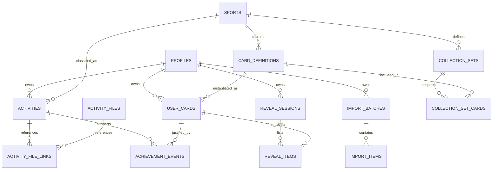

# LAUNCH V1 — Modèle de données PostgreSQL (spécification logique)

Ce fichier est un **modèle cible**, pas une migration SQL exécutable. Codex doit produire les migrations versionnées dans `supabase/migrations`, avec clés étrangères, index, RLS et tests de sécurité.

## 1. Entités principales

| Table | Champs structurants (simplifiés) | Contraintes / remarques |
|---|---|---|
| `profiles` | `user_id PK/FK auth.users`, `handle`, `display_name`, `created_at` | Privé par défaut ; `handle` unique si activé |
| `sports` | `id PK`, `slug UNIQUE`, `name`, `is_active`, `created_at` | Les quatre sports en seed ; extensible |
| `import_batches` | `id PK`, `user_id FK`, `kind`, `status`, `total_files`, `processed_files`, `created_at`, `completed_at`, `idempotency_key` | `UNIQUE(user_id,idempotency_key)` ; `initial` ou `subsequent` |
| `activity_files` | `id PK`, `user_id FK`, `sha256`, `storage_path`, `format`, `bytes`, `uploaded_at` | `UNIQUE(user_id,sha256)` ; Storage privé |
| `activities` | `id PK`, `user_id FK`, `sport_id FK NULL`, `original_sport`, `source`, `source_activity_id NULL`, `started_at_utc`, `distance_m`, `duration_s`, `elevation_gain_m`, `status`, `evidence_level`, `created_at` | Toutes catégories, y compris inconnues ; index `(user_id,started_at_utc)` |
| `activity_file_links` | `activity_id FK`, `file_id FK`, `user_id FK`, `relation` | Une activité peut avoir plusieurs fichiers ; clé composite ; propriétaire identique vérifié |
| `import_items` | `id PK`, `batch_id FK`, `user_id FK`, `file_id NULL`, `activity_id NULL`, `state`, `warning_codes JSONB`, `source_item_key` | `UNIQUE(batch_id,source_item_key)` ; reprise et audit |
| `collection_sets` | `id PK`, `sport_id FK`, `code`, `version`, `title`, `bonus_card_id NULL`, `active` | Ensemble permanent versionné |
| `card_definitions` | `id PK stable`, `sport_id FK`, `title`, `rarity`, `kind`, `rule_type`, `rule_payload JSONB`, `ruleset_version`, `art_asset`, `active` | Catalogue administré côté serveur |
| `collection_set_cards` | `collection_set_id FK`, `card_id FK`, `is_required` | `UNIQUE(collection_set_id,card_id)` |
| `user_cards` | `id PK`, `user_id FK`, `card_id FK`, `status`, `first_awarded_at`, `ruleset_version` | `UNIQUE(user_id,card_id)` ; source de vérité |
| `achievement_events` | `id PK`, `user_id FK`, `user_card_id FK`, `activity_id NULL`, `event_type`, `ruleset_version`, `created_at`, `details JSONB` | Trace la justification, l'annulation et les recalculs |
| `reveal_sessions` | `id PK`, `user_id FK`, `kind`, `status`, `created_at`, `seen_at NULL`, `import_batch_id NULL` | `initial_collection`, `new_achievements`, `new_sport_collection` |
| `reveal_items` | `id PK`, `session_id FK`, `user_card_id FK`, `ordinal`, `seen_at NULL` | `UNIQUE(user_card_id)` pour révélation initiale unique |
| `account_deletion_jobs` | `id PK`, `user_id`, `status`, `created_at`, `error_code NULL` | Journal technique minimal pour purge Storage + base |

**Enrichissements futurs** (non implémentés) : `activity_source_connections`, `cosmetic_items`, `user_inventory`, `avatar_loadouts`, `brand_collections`, `friendships`, `entitlements`.

## 2. Diagramme ER simplifié

## 3. Enums / contraintes recommandées

- `activities.status`: `valid`, `needs_review`, `excluded`, `deleted`.
- `activities.evidence_level`: `file_import`, `self_reported`, `provider_verified` (futur ; non utilisé V1).
- `import_batches.status`: `created`, `analysing`, `awaiting_review`, `committing`, `completed`, `partial`, `failed`, `cancelled`.
- `import_items.state`: `parsed`, `needs_review`, `duplicate_exact`, `duplicate_candidate`, `committed`, `ignored`, `failed`.
- `user_cards.status`: `active`, `revoked` ; **ne pas retirer silencieusement** une carte en cas de correction du classement sportif.
- `achievement_events.event_type`: `awarded`, `reconfirmed`, `revoked`, `restored`.
- `reveal_sessions.status`: `pending`, `viewing`, `seen`.
- `reveal_sessions.kind`: `initial_collection`, `new_achievements`, `new_sport_collection`.
- Distances en mètres (`numeric` ou `double precision` selon politique de précision), durées en secondes entières, temps en `timestamptz` UTC.
- Données sportives brutes et originales non mises en colonne `public` ; référencer Storage privé.

## 4. Index et garanties métier

1. `UNIQUE(user_id,card_id)` sur `user_cards` : aucun doublon de carte de jalon.
2. `UNIQUE(user_id,sha256)` sur `activity_files` : fichiers exacts dédupliqués par utilisateur.
3. `UNIQUE(user_id,idempotency_key)` sur `import_batches` : pas de double création d'un import.
4. `UNIQUE(batch_id,source_item_key)` sur `import_items` : rejouer un lot est sans effet secondaire.
5. `UNIQUE(user_id,source,source_activity_id)` **partiel** lorsque `source_activity_id IS NOT NULL` et la source le rend fiable.
6. Index `(user_id,started_at_utc DESC)`, `(user_id,sport_id)`, `(user_id,status)` sur `activities`.
7. Index `(user_id,created_at DESC)` sur `reveal_sessions` et `(user_id,status)` sur `user_cards`.
8. Garantir par FKs/composite FKs ou triggers contrôlés que les objets liés appartiennent au même utilisateur.
9. Dans une transaction : insertion activity + user_card + achievement_event + reveal_item ; avec `ON CONFLICT DO NOTHING` et restitution des seuls **nouveaux** enregistrements.
10. Le moteur doit réévaluer les cartes après reclassification et, s'il ne reste aucune activité probante, signaler une révocation à confirmer et tracer l'événement.

## 5. RLS et droits

| Table | Lecture utilisateur | Écriture utilisateur directe | Écriture serveur |
|---|---|---|---|
| `profiles` | Propre profil | Ses champs éditables uniquement | Création initiale / suppression |
| `sports`, `card_definitions`, `collection_sets` | Catalogue actif | Non | Oui, migrations/admin |
| `activities`, `import_batches`, `import_items`, `activity_files` | Uniquement ses lignes | Via endpoints encadrés ; pas de mutation arbitraire des champs de validation | Oui |
| `user_cards`, `achievement_events`, `reveal_items` | Uniquement ses lignes | Non | Oui |
| `reveal_sessions` | Uniquement ses lignes | Marquer `seen` via endpoint limité | Oui |

Tester systématiquement utilisateur A vs utilisateur B, insertion directe et écriture d'ID utilisateur choisi par client. Les règles RLS doivent être couplées aux **GRANT/REVOKE**, et le service role ne doit jamais apparaître dans un bundle frontend.

## 6. Politique de fichiers et suppression

Le chemin Storage ne suffit pas à faire une protection : vérifier l'ownership en base et les policies Storage. Lors de la suppression d'une activité ou d'un compte, supprimer également les fichiers non partagés par d'autres activités du même utilisateur ; traiter les échecs Storage en tâches réessayables. Le système doit permettre de **réconcilier les références orphelines**.

## 7. Option : future activation d'un sport

1. Migration seed `sports` + `card_definitions` + `collection_set_cards` avec nouvel identifiant/version.
2. Batch de reclassification des activités `unsupported` sur base du `original_sport` et, lorsque nécessaire, relecture des fichiers originaux.
3. Recalcul idempotent des cartes, sans modification des anciennes possessions valides.
4. Nouvelle `reveal_session` du type `new_sport_collection` pour les nouvelles cartes uniquement.
5. Aucun besoin de redemander les activités **si les données requises ont été conservées**.
