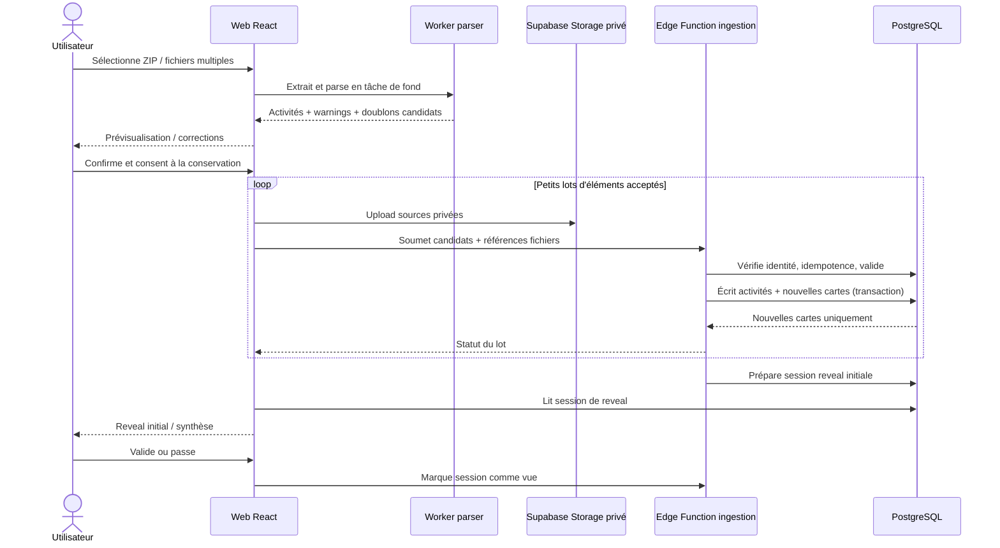
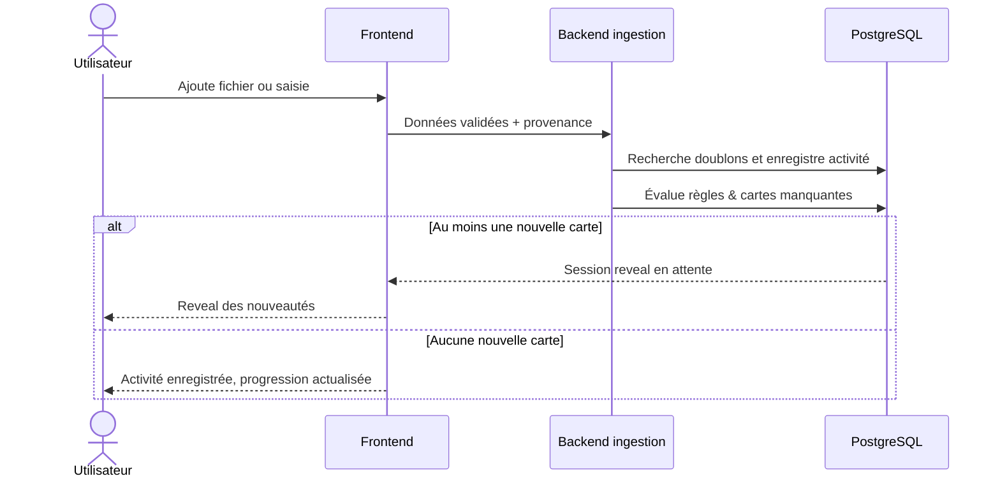
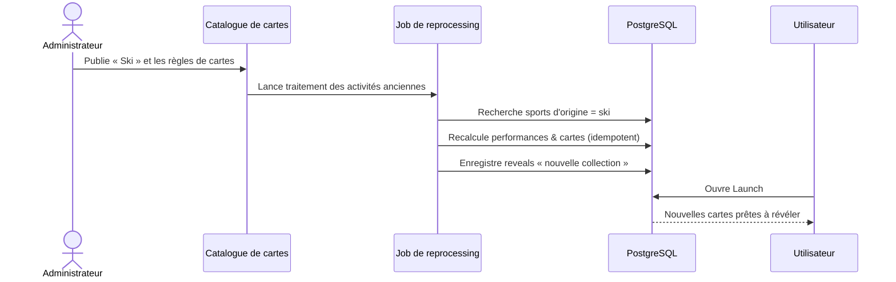

# LAUNCH V1 — Parcours UX et diagrammes de séquence

## 1. Inventaire des écrans

| ID | Écran | Objectif | État principal | États alternatifs |
|---|---|---|---|---|
| E01 | Bienvenue | Comprendre Launch et commencer | Hero + CTA | Déjà connecté → accueil |
| E02 | Auth | Inscription et connexion | Formulaire + validation | Erreurs e-mail, mot de passe, réseau |
| E03 | Onboarding | Inviter à importer tout son historique | « Importer mes activités » | Passer pour plus tard |
| E04 | Import | Déposer ZIP ou multifichiers | Zone de sélection et formats | Fichier trop gros, format non pris en charge |
| E05 | Analyse d'import | Visualiser le parsing local | Compteur réel + annulation | Fichier corrompu, erreur ZIP |
| E06 | Revue d'import | Corriger, accepter, exclure | Tableau/cartes par statut | Doublon probable, sport inconnu |
| E07 | Progression commit | Suivre l'envoi et la validation | % des lots réussis | Pause/reprise, réseau perdu |
| E08 | Reveal initial | Découvrir les cartes d'historique | Intro, raretés, synthèse | 0 carte, plusieurs dizaines, skip |
| E09 | Accueil | Progresser et retourner explorer | 4 sports, dernière carte | Collection vide, reveal en attente |
| E10 | Collections | Voir les 4 ensembles | Vignettes et progression | Catégorie sans carte |
| E11 | Collection sport | Voir les cartes verrouillées/possédées | Grille de cartes | Complétion, bonus |
| E12 | Carte détail | Comprendre et valoriser l'exploit | Carte, règle, preuve | Verrouillée, activité supprimée |
| E13 | Activités | Gérer son historique | Liste filtrable | Aucune activité, unsupported |
| E14 | Activité détail | Comprendre la classification | Sport, métriques, provenance | Correction, needs_review |
| E15 | Ajouter activité | Nouveau fichier ou saisie manuelle | Deux modes d'ajout | Fichier invalide, champ manquant |
| E16 | Profil & paramètres | Compte, confidentialité, suppression | Informations et gestion de données | Confirmations destructives |
| E17 | Reveal quotidien | Montrer uniquement les nouveautés | Une ou plusieurs nouvelles cartes | Skip, reprise, 0 carte |

## 2. Navigation mobile proposée

```text
Accueil ─── Collections ─── Activités ─── Profil
   │             │              │           │
   ├─ Reveal     ├─ Sport        ├─ Détail    └─ Paramètres
   └─ Ajouter    └─ Carte        └─ Import / Saisie
```

### Détails ergonomiques

- Barre inférieure permanente sur les principaux écrans, masquée sur un reveal plein écran.
- Bouton `+ Activité` accessible depuis accueil et activités.
- Cartes avec `aspect-ratio` stable, chargement progressif et variante réduisant les animations.
- Aucun effet 3D lourd en V1 ; transitions CSS / Motion, préchargées pour une seule révélation à la fois.
- Respect des zones de sécurité mobile, de `prefers-reduced-motion` et des tailles de police utilisateur.

## 3. Séquence — premier import et reveal



## 4. Séquence — ajout d'activité après inscription



## 5. Séquence — ajout d'un cinquième sport plus tard



## 6. Scénarios de test UX

- **A** : nouvel utilisateur, ZIP 200 fichiers, 18 cartes gagnées → reveal initial groupé puis collections et compteurs corrects.
- **B** : utilisateur importe trois fois une même course → 1 activité logique, 1 exemplaire de chaque carte atteinte.
- **C** : fichier Trail contenant sport « running » sans précision → classé Running ou `unknown` selon mapping, pas Trail inféré du D+ ; correction possible.
- **D** : 40 sorties Ski stockées → aucune carte aujourd'hui ; deviennent éligibles lorsque Ski est ajouté, sans réimport si source conservée.
- **E** : coupure réseau à 60 % de commit → restauration de la progression et reprise des lots manquants.
- **F** : fermeture pendant reveal → cartes possédées en base, session toujours accessible à l'ouverture.
- **G** : compte sans activité → quatre collections visibles, CTA import bien présenté.
- **H** : import GPX de simple parcours sans horodatage → `needs_review` sans récompense automatique.
- **I** : suppression du compte → activités, cartes et fichiers retirés ; suivi des erreurs de purge.


## Compléments du design validé

Voir `docs/07_design_system.md` et `docs/08_navigation_et_ecrans.md`. Les 23 écrans de la maquette sont un ensemble de vision produit ; les quatre onglets V1 restent Accueil, Collections, Activités, Profil.
