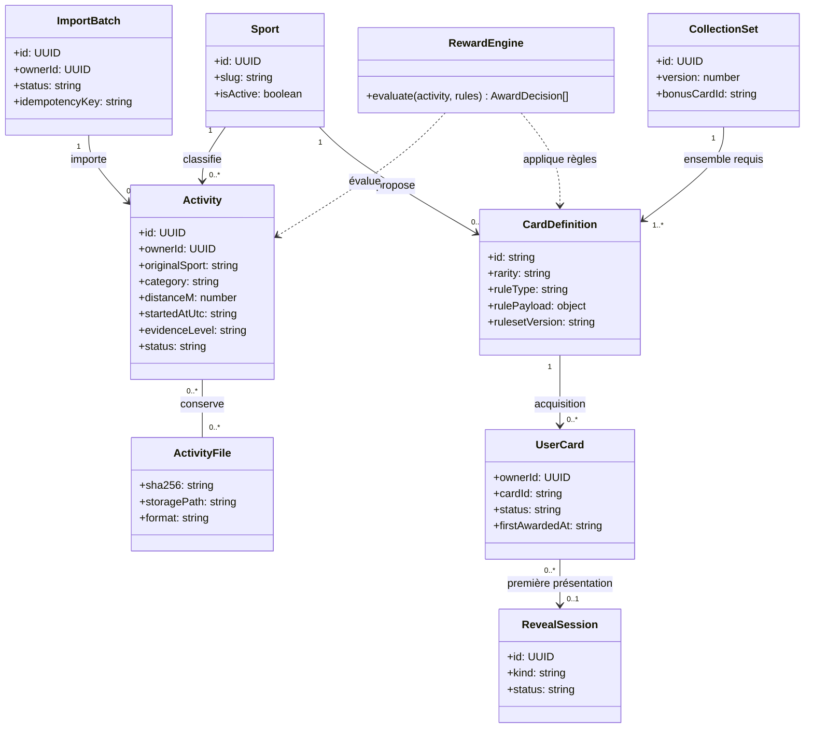

# LAUNCH V1 — Diagramme de classes métier (conceptuel)

Ce diagramme décrit les objets métier principaux et leurs relations, **pas** des classes ORM obligatoires. Dans l'implémentation React/Supabase, les domaines seront surtout représentés par des types TypeScript, fonctions pures et tables SQL.

## Invariants de domaine

- `RewardEngine` n'a aucune responsabilité d'affichage, d'import ZIP ou d'enregistrement en base.
- `UserCard` est persistante et unique par `(ownerId,cardId)`.
- `RevealSession` présente des objets déjà attribués ; elle ne modifie jamais la propriété des cartes.
- `Sport` et `CardDefinition` sont alimentés par catalogue versionné ; les nouvelles disciplines n'exigent pas un changement de type source dans le backend.
